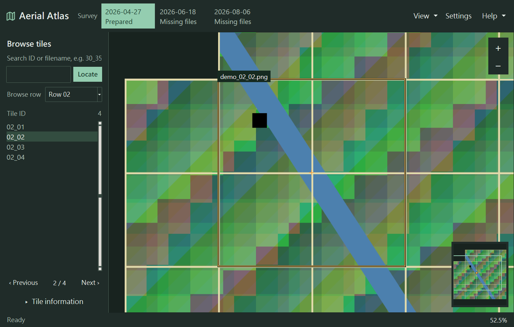

# Aerial Atlas

Browse the April, June and August surveys and inspect each tile in context.

**[Download for Windows (64-bit)](https://github.com/ljc-1222/aerial-atlas/releases/latest/download/aerial-atlas-windows-x64.zip)** · [All releases](https://github.com/ljc-1222/aerial-atlas/releases)

Extract the entire ZIP and run **`AerialAtlas.exe`**. Keep the `_internal` folder
beside it. Python is not required.



## First use

Download the survey files separately from their owner. Save the original ZIPs
and source TIFFs in `<app folder>/images/`, or leave them in your download folder
and select **Choose download folder** in the app. No manual extraction or
renaming is needed. Wait for all downloads to finish before checking them.

```text
aerial-atlas/
  AerialAtlas.exe
  _internal/
  images/
    1150618-...-002.zip
    1150618-...-003.zip
    1150618_input_orthomosaic-001.tif
    ...
```

Open the application, select a **Survey**, and choose **Create map** once.
The app extracts recognized imagery and arranges each date under
`images/<survey>/tiles_png_1024/`. An existing April `RGB_png` folder is adapted
automatically; its original image filenames and pixels stay unchanged.

April map creation can take several minutes. June and August use their supplied
source TIFFs directly. Later launches reuse the prepared map or index under
`generated/<survey>/`. Keep the source files unchanged during preparation;
interrupted imports can be retried.

## Explore

- Select a tile ID or search a filename / `row_column` to outline and center it
  with **1.5× context**.
- Filter by row or use Previous / Next to browse. Right-click the map to choose
  between overlapping tiles.
- Drag to pan, use the mouse wheel to zoom, and press Home to fit the map.
- Open Settings to change language, appearance or display options. The Help menu
  lists keyboard shortcuts.
- Switch surveys from the selector at the top. Each survey remembers its view.

The viewer uses image pixel coordinates. Survey metadata retains any source
georeferencing; switching dates does not align their views geographically.
See the [dataset requirements](docs/dataset.md) for supported layouts.

## Try without a dataset

Run this command from the extracted application folder in PowerShell:

```powershell
.\AerialAtlas.exe --demo --project-dir "$env:TEMP\aerial-atlas-demo"
```

Choose **Create map** when the window opens. The demo creates synthetic tiles and
requires an empty destination source folder.

## Troubleshooting

| Problem | What to check |
|---|---|
| Tiles not found | Select the survey and folder containing its downloaded ZIPs or extracted date folder, then choose Check again. |
| Source TIFF missing | June and August need their `input_orthomosaic` TIFF as well as the tile ZIPs. |
| Two tile folders contain files | Keep one complete `RGB_png` or `tiles_png_1024` folder; the app refuses to silently hide or overwrite images. |
| Overlapping pixels disagree | For April reconstruction, use unchanged tiles from the same orthophoto. |
| Not enough space or permission denied | Use a writable folder and free the space indicated by the application. |
| App will not start or a DLL is missing | Extract the whole ZIP again; copying only the EXE is insufficient. |

[Report an issue](https://github.com/ljc-1222/aerial-atlas/issues) with the app
version, error message and whether the demo works. Do not attach private imagery
or unredacted logs.

## Development and license

See [CONTRIBUTING.md](CONTRIBUTING.md) to run from source, test and build the app.

Licensed under [Apache-2.0](LICENSE). Bundled dependencies retain their own
licenses; see [third-party notices](THIRD_PARTY_NOTICES.md).
